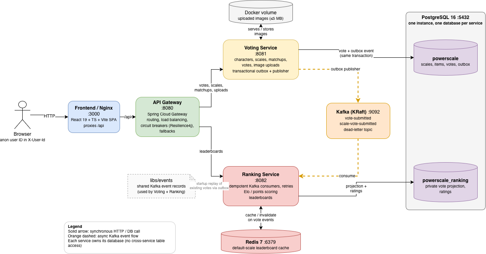

# Powerscale

A community-driven powerscaling platform. Users can create their own scales for any topic, define their own vote
options and scoring, and share a public link. Votes are written to PostgreSQL,
published through Kafka, and materialized into leaderboards by a separate ranking
service.

## Features

- **Scales index** — search and open the bundled default scale or any user-created scale.
- **Custom scales** — title, criterion, 1–3 vote options, public share link.
- **Default scale** — a bundled roster with three fixed vote options and manual character editing.
- **Two scoring methods** — Elo or fixed points, configured per scale.
- **Anonymous voting** — one ballot per browser per matchup; votes can be changed.
- **Manual roster editing** — add characters or scale items with a name and uploaded image.
- **Image uploads** — JPEG, PNG, WebP, and GIF up to 5 MB.
- **Async rankings** — transactional outbox, Kafka, idempotent consumers, retries, and a dead-letter topic.
- **Leaderboards** — Elo or points rankings with win/loss records and win rates.
- **Redis cache** — Default-scale leaderboard responses are cached and invalidated by vote events.
- **Gateway** — routing, load balancing, circuit breakers, and fallback responses.

## Architecture



The diagram shows synchronous HTTP and database calls as solid arrows, and the
asynchronous outbox-to-Kafka-to-Ranking-Service flow as dashed arrows.

| Service | Port | Responsibility |
|---|---|---|
| Frontend / Nginx | 3000 | SPA, `/api` proxy to the Gateway |
| API Gateway | 8080 | Routing, circuit breaking, load balancing |
| Voting Service | 8081 | Characters, scales, matchups, votes, image uploads, outbox |
| Ranking Service | 8082 | Kafka consumers, score calculation, leaderboards |
| PostgreSQL | 5432 | `powerscale` and `powerscale_ranking` databases |
| Kafka | 9092 | `vote-submitted` and `scale-vote-submitted` topics |
| Redis | 6379 | Default scale leaderboard cache |

Each service owns its database. The two databases run on one PostgreSQL
instance; no cross-service table access is used.

## Voting and scoring

The default scale uses three fixed selections: Low, Mid, and High.

Custom scales define 1–3 selections. A new scale defaults to one selection named
`Winner`. Each selection carries a value:

- **Elo** — the value is a difficulty weight.
- **Points** — the value is the number of points awarded for a win.

Elo calculation:

```text
E = 1 / (1 + 10^((opponentRating - rating) / 400))
winnerDelta = K * selectionWeight * (1 - E)
loserDelta = -winnerDelta
```

Base rating and K factor are configurable at scale creation. Points scoring adds
the selected value to the winner and zero to the loser. Votes are replayed in
chronological order so ratings are deterministic.

There are no accounts. The frontend generates a browser user ID and sends it as
`X-User-Id`. A unique `(user_id, matchup_id)` constraint prevents duplicate
ballots; submitting again replaces the previous choice.

## Data flow

1. The browser requests a random matchup through the Gateway.
2. The Voting Service returns two items from the selected scale.
3. A vote is written to PostgreSQL together with an outbox event in the same transaction.
4. The outbox publisher sends the event to Kafka.
5. The Ranking Service deduplicates by event ID, ignores stale vote versions, and updates its private vote projection.
6. Ratings are recomputed for that scale and the leaderboard is served from the Ranking Service.
7. Existing votes are queued into the outbox on startup so a new Ranking Service can rebuild from history.

Default scale votes use `vote-submitted`; custom scale votes use
`scale-vote-submitted`.

## API

| Method | Path | Purpose |
|---|---|---|
| GET | `/api/scales?search=&page=&size=` | Scale index |
| POST | `/api/scales` | Create a scale |
| GET | `/api/scales/{slug}` | Scale details and items |
| POST | `/api/scales/{slug}/items` | Add items |
| GET | `/api/scales/{slug}/matchups/random` | Random matchup |
| POST | `/api/scales/{slug}/votes` | Submit a scale vote |
| GET | `/api/scale-leaderboard/{scaleId}` | Scale rankings |
| GET | `/api/matchups/random` | Random default-scale matchup |
| POST | `/api/votes` | Submit a default-scale vote |
| GET | `/api/leaderboard` | Default-scale rankings |
| POST | `/api/characters/manual` | Add default-scale characters |
| POST | `/api/uploads/images` | Upload an image |

All vote endpoints require `X-User-Id`.

## Project structure

```text
.
├── docker/                    # service Dockerfiles and Nginx config
├── docker-compose.yml         # full stack and infrastructure
├── frontend/                  # React + TypeScript + Vite
├── infra/postgres/init/       # ranking database bootstrap
├── libs/events/               # shared Kafka event records
├── loadtest/voting.js         # k6 voting load test
├── scripts/init-databases.sh  # creates the ranking database on existing volumes
├── services/
│   ├── api-gateway/
│   ├── ranking-service/
│   └── voting-service/
├── powerscale-architecture.png # architecture diagram
├── Makefile
└── pom.xml
```

## Tech stack

| Layer | Technology |
|---|---|
| Frontend | React 19, TypeScript, Vite, Nginx |
| Gateway | Spring Cloud Gateway, Resilience4j |
| Backend | Java 21, Spring Boot 3.4, Spring Data JPA, Flyway |
| Messaging | Apache Kafka (KRaft) |
| Data | PostgreSQL 16, Redis 7 |
| Infra | Docker, Docker Compose |
| Testing | JUnit 5, MockMvc, H2, k6 |
